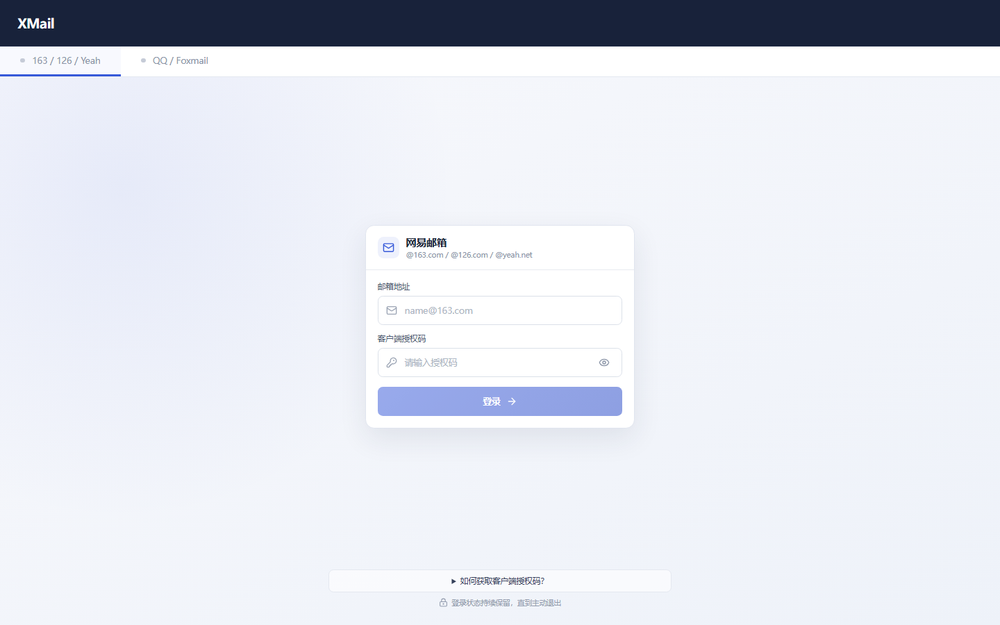
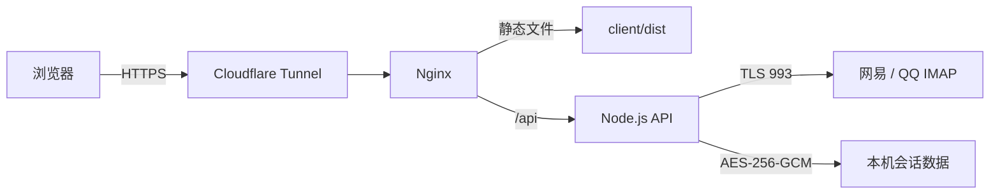

<div align="center">
  
  <h1>XMail</h1>
  <p>轻量、私有、自托管的网易与 QQ 网页邮箱。</p>
  <p>
    
    
    
    
    
  </p>
  <p><a href="https://ayurain.top/"><strong>在线预览：ayurain.top</strong></a></p>
</div>

XMail 是一个轻量、专注的自托管网页邮箱，面向希望自行掌控邮箱访问凭据与部署环境的用户。项目精简了传统网页邮箱中较为臃肿的功能与复杂入口，将体验集中在邮件浏览、搜索、聚合和常用管理操作上，减少不必要的页面负担与交互等待，让日常收信和查找邮件更加清爽、流畅。

浏览器只访问你自己部署的 XMail 服务，服务端通过 TLS IMAP 连接网易或 QQ 邮箱，不依赖桌面客户端和第三方邮件聚合平台。

## 界面预览

<p align="center">
  <a href="https://ayurain.top/">
    
  </a>
</p>

## 功能特性

- 网易与 QQ 双账号标签页，账号状态互相隔离。
- 收件箱、已发送、草稿箱、垃圾箱等 IMAP 文件夹浏览。
- 邮件按日期从新到旧排列，支持增量加载和虚拟列表。
- 按发件人、收件人、主题与正文进行服务端搜索。
- 按发件人或主题聚合邮件，聚合项统一置顶。
- 已读、未读、星标、批量操作与自定义右键菜单。
- HTML/纯文本邮件阅读、内嵌图片与附件下载。
- 默认拦截远程图片，降低追踪像素和阅读回执暴露。
- 桌面端与移动端响应式界面。
- 登录会话加密持久化，主动退出前持续保留。

## 支持的邮箱

| 邮箱 | 支持域名 | IMAP 服务 |
| --- | --- | --- |
| 网易 | `163.com`、`126.com`、`yeah.net`、`vip.163.com`、`vip.126.com`、`188.com` | 对应网易官方 TLS 993 服务 |
| 腾讯 | `qq.com`、`foxmail.com` | `imap.qq.com:993` |

登录前需要先在邮箱网页端开启 IMAP，并生成客户端授权码或应用专用密码。请勿填写邮箱网页登录密码。

## 系统架构



客户端与服务端完全独立：

```text
XMail/
├─ client/                 Vue 3 + Vite 客户端
│  ├─ public/              favicon 等公开资源
│  ├─ src/                 页面、组件与交互逻辑
│  ├─ package.json         客户端依赖与命令
│  └─ vite.config.js
├─ server/                 Node.js + Express 服务端
│  ├─ src/                 API、IMAP、搜索与会话逻辑
│  ├─ data/                本机加密会话数据，不提交 Git
│  ├─ .env.example         服务端环境变量示例
│  └─ package.json         服务端依赖与命令
├─ docs/                   部署等扩展文档
├─ CONTRIBUTING.md         贡献指南
├─ SECURITY.md             安全策略
├─ CHANGELOG.md            版本记录
└─ LICENSE                 MIT 许可证
```

生产环境由 Nginx 托管 `client/dist`，并将同源 `/api/` 请求反向代理到 Node.js `3000` 端口。服务端不会读取或托管客户端文件。

## 快速开始

环境要求：

- Node.js 20.19 或更高版本
- 可访问邮箱 IMAP TLS 993 端口

启动服务端：

```powershell
Set-Location server
npm install
Copy-Item .env.example .env
npm run dev
```

打开另一个终端启动客户端：

```powershell
Set-Location client
npm install
npm run dev
```

访问 <http://localhost:5173>。开发服务器会将 `/api` 代理到 <http://127.0.0.1:3000>。

## 生产构建

```powershell
Set-Location client
npm ci
npm run build
```

构建结果位于 `client/dist/`。服务端可独立安装并启动：

```powershell
Set-Location server
Copy-Item .env.example .env
npm ci --omit=dev
npm start
```

Windows、Nginx、Cloudflare Tunnel 和 Windows 服务的完整步骤见 [Windows 部署指南](docs/WINDOWS_DEPLOYMENT.md)。

## 服务端配置

| 变量 | 默认值 | 说明 |
| --- | --- | --- |
| `PORT` | `3000` | Node API 监听端口 |
| `SESSION_SECRET` | 自动生成本机密钥 | 会话加密密钥；显式配置后必须长期保持不变 |
| `XMAIL_DATA_DIR` | `server/data` | 加密会话与本机密钥目录 |
| `NODE_ENV` | `development` | 设为 `production` 时启用 Secure Cookie |

生产环境示例：

```env
NODE_ENV=production
PORT=3000
SESSION_SECRET=replace-with-a-long-stable-random-secret
XMAIL_DATA_DIR=D:/Web/XMailData
```

## 安全说明

- 浏览器只保存 `HttpOnly`、`SameSite=Strict` 的随机会话 Cookie。
- 邮箱授权码使用 AES-256-GCM 加密后保存在服务端数据目录。
- IMAP 主机由邮箱白名单固定，客户端无法提交任意服务器地址。
- HTML 邮件展示前经过 DOMPurify 清理，并默认阻止远程资源。
- 登录接口包含进程内频率限制。
- 当前会话存储为单机加密文件，不适合多个服务端实例同时写入。

公网部署必须使用 HTTPS。不要提交 `.env`、`server/data`、授权码、会话文件或真实邮件内容。安全问题请按照 [安全策略](SECURITY.md) 私下报告。

## 参与贡献

欢迎提交缺陷修复、兼容性改进、界面优化与文档更新。开始前请阅读 [贡献指南](CONTRIBUTING.md) 和 [行为准则](CODE_OF_CONDUCT.md)。

## 版本记录

项目变更记录见 [CHANGELOG.md](CHANGELOG.md)。

## 许可证

本项目使用 [MIT License](LICENSE) 开源。你可以使用、复制、修改和分发本项目，但需要保留原始版权与许可声明。
