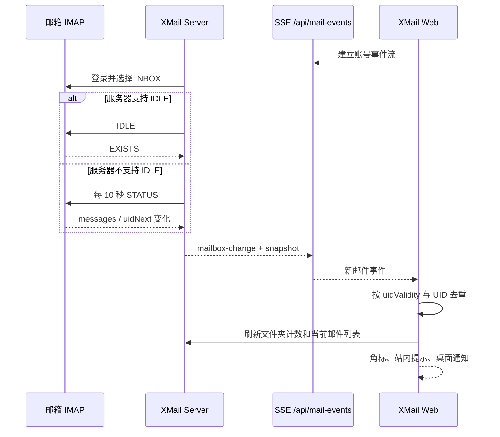

# 实时新邮件监听与提醒

XMail 在网页保持打开且邮箱账号已连接时监听收件箱变化，并提供以下功能：

- 收到新邮件后自动刷新当前收件箱。
- 非当前账号显示新邮件数量角标。
- 页面内显示包含发件人和主题的提示。
- 用户授权后显示浏览器桌面通知。
- 点击桌面通知后聚焦 XMail，并打开对应账号的收件箱。
- 连接中断后自动重连，并通过 IMAP UID 校准断线期间到达的邮件。

该功能不依赖 WebSocket 或第三方推送服务。浏览器通过同源 SSE 接收服务端事件，服务端通过标准 IMAP 能力监听邮箱。

## 服务商能力与监听策略

XMail 在 IMAP 登录后读取服务器的 `CAPABILITY`，根据实际能力自动选择监听方式。

| 邮箱端点 | 当前能力 | XMail 策略 | 通常延迟 |
| --- | --- | --- | --- |
| `imap.qq.com` | 支持 `IDLE` | IMAP IDLE 实时监听 | 通常数秒内 |
| `imap.yeah.net` | 支持 `IDLE` | IMAP IDLE 实时监听 | 通常数秒内 |
| `imap.163.com` | 未声明 `IDLE` | 每 10 秒执行一次轻量 `STATUS` | 约 1～10 秒，加邮件投递时间 |
| `imap.126.com` | 未声明 `IDLE` | 每 10 秒执行一次轻量 `STATUS` | 约 1～10 秒，加邮件投递时间 |
| 网易 VIP、188 | 以登录后的能力为准 | 自动选择 IDLE 或 `STATUS` | 取决于服务器能力 |

表格记录的是开发时对官方 IMAP 端点的实际能力探测结果。邮箱服务商可能调整能力，因此运行时检测始终是最终依据。

网易端点可能声明 `XAPPLEPUSHSERVICE`，但它是面向 Apple Push Service 的扩展，并非普通网页应用可以直接使用的标准推送接口。网易网页端使用的内部消息通道也不等同于对第三方开放的 IMAP IDLE。

`STATUS` 兼容监听只会用于没有 IDLE 能力的账号。支持 IDLE 的 QQ、Foxmail 和 Yeah 不会执行周期检查。

## 数据流



服务端为每个“会话 + 邮箱账号”共享一条 watcher，避免同一页面的重复连接。SSE 断开且没有订阅者后，watcher 会在短暂宽限期后关闭 IMAP 连接。

收到 IMAP 变化时，服务端先发送轻量 `mailbox-change` 事件，再推送包含最近邮件摘要的 `snapshot`。浏览器优先使用长连接快照；如果快照没有及时到达，才会通过普通 API 拉取一次快照。这是事件触发的校准，不是定时轮询。

## 提醒规则

- 页面内提示始终可用，不需要浏览器通知权限。
- 当前账号、收件箱可见且页面处于前台时，不累加账号角标。
- 其他账号、其他文件夹、后台标签页或失去焦点时，会累加账号角标。
- 桌面通知默认关闭，需要点击页面顶部的“开启新邮件提醒”。
- 桌面通知要求浏览器授权；生产环境必须通过 HTTPS 访问。
- 浏览器页面完全关闭后，不会继续监听或显示桌面通知。当前实现不是 Service Worker 后台推送。

## 部署要求

新邮件功能同时包含客户端和服务端代码，首次部署或更新相关代码时需要：

1. 重新构建并发布 `client/dist`。
2. 更新服务端源码并重启 Node.js 服务。
3. 确保服务器可以出站访问邮箱的 TCP 993 端口。
4. 确保 Nginx 对 `/api/` 禁用响应缓冲。

Nginx 的关键配置：

```nginx
location ^~ /api/ {
    proxy_pass http://127.0.0.1:3000;
    proxy_http_version 1.1;
    proxy_set_header Connection "";
    proxy_read_timeout 180s;
    proxy_send_timeout 180s;
    proxy_buffering off;
}
```

SSE 连接由服务端每 25 秒发送一次心跳，因此不需要单独开放端口，也不需要部署 WebSocket 服务。

## 排查方法

1. 打开浏览器开发者工具的“网络”面板。
2. 找到 `/api/mail-events?accountId=...` 请求。
3. 请求应返回 `200`，类型应为 `text/event-stream`，并持续保持 pending 状态。
4. 如果请求反复断开，确认 Nginx 已设置 `proxy_buffering off`，并检查代理超时时间。
5. 如果页面显示“邮箱实时连接暂时不可用”，检查服务端以 `[mail-watcher]` 开头的日志。
6. 确认部署机器可以连接对应邮箱的 TLS 993 端口，且邮箱授权码仍然有效。
7. 网易 163/126 使用 10 秒兼容监听，测试时应至少等待一个完整检查周期，并额外考虑邮件服务商自身的投递时间。
8. 若站内提示正常但没有桌面通知，检查浏览器的网站通知权限和 HTTPS 状态。

实时连接恢复后，XMail 会重新读取收件箱快照；相同 UID 不会重复提醒。
